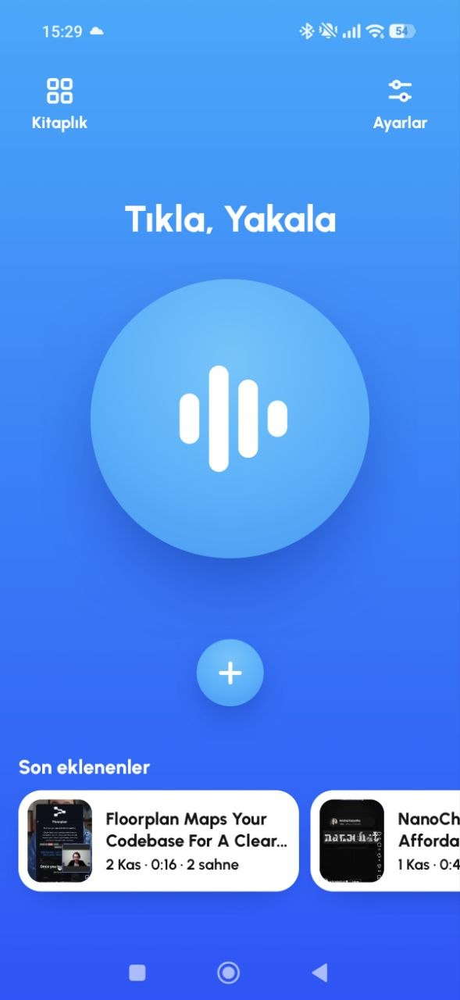
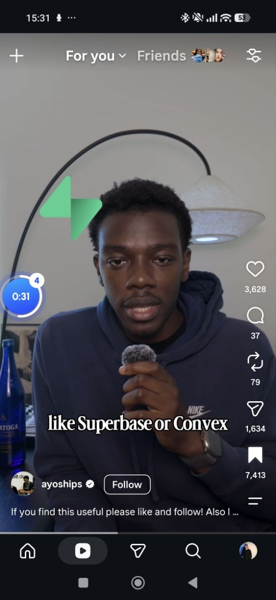
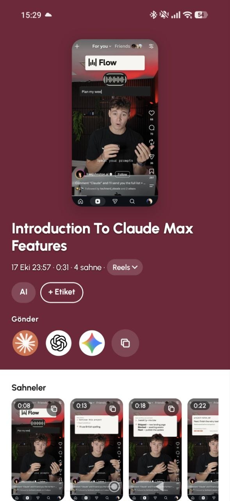
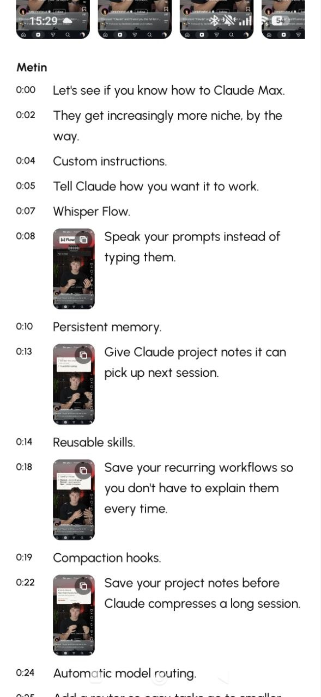
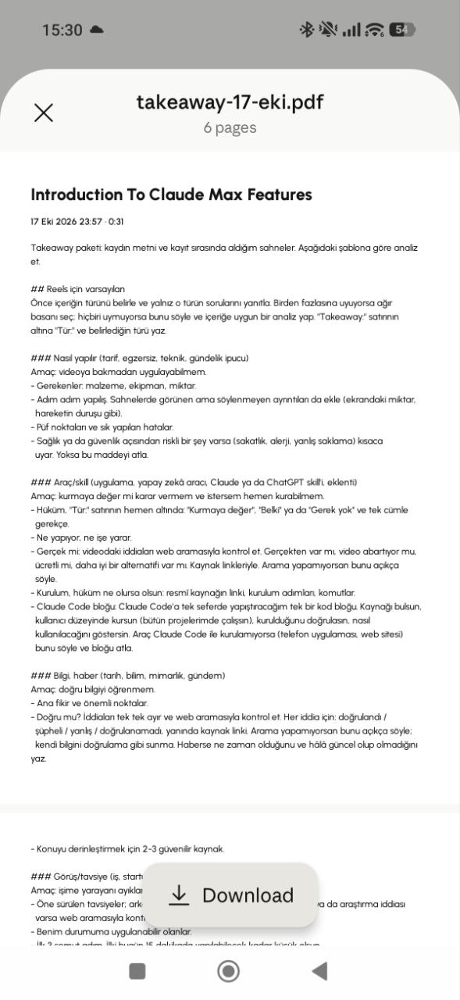
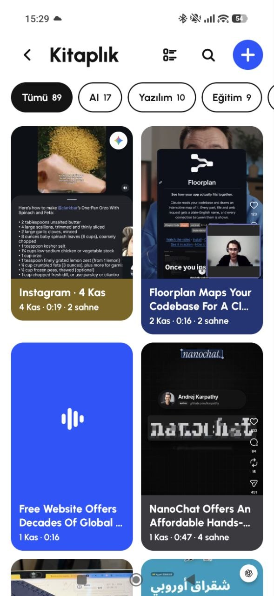

# Takeaway

**Capture a Reel or a conversation on your phone and hand it to your own AI, ready to analyse.**

Android · October 2026 · Personal project

> The source code is private. This page describes the product; a live walkthrough is available on request.

## The problem

Getting the lesson out of a short video or a call took five steps and a computer: screen-record, transfer the file, transcribe it, paste the text into an AI chat, write a prompt. Takeaway does the same on the phone in a few taps, without leaving what you are watching.

  
  
  

  
  
  

## What it does

- **Capture without leaving Instagram.** A small side button sits next to Instagram's controls. One tap starts the capture, recording begins from the start of the Reel, and swiping to the next Reel or leaving Instagram ends it.
- **Scenes in one tap.** Tap the button to take a screenshot of that moment; the button never appears in the frame.
- **Transcribed in the background.** Speech is turned into text while you keep watching; a notification says when the package is ready.
- **One package, your AI.** The transcript, scenes and an analysis template are combined into a single PDF and sent to a new chat in a Claude or ChatGPT project, or to Gemini.
- **Calls and recordings too.** Share or import WhatsApp calls and other audio or video files. Transcripts are separated by speaker, with names, merging, splitting and Undo; tapping a line plays that moment.
- **A library to come back to.** Grid and list views, search across titles and transcripts, on-device AI topic tags, and "Open in Instagram" to return to the original video.

## Product principles

1. **Don't break the viewing.** Capturing, taking scenes and finishing all happen without leaving Instagram.
2. **The thinking belongs to the user's AI.** Takeaway prepares and delivers; the user's own Claude, ChatGPT or Gemini workspace, with its memory and instructions, does the analysis. No LLM API and no server.
3. **Private by default.** Nothing is written to the gallery, captured audio is deleted once transcribed, and the transcription key stays on the phone.
4. **Measured, not assumed.** Every capture behaviour was verified on a real phone before it counted as done, and features that did not hold up in testing were redesigned.

## Built with

Kotlin · Jetpack Compose · Material 3 · Android screen and audio playback capture · Accessibility service (scroll detection only) · AssemblyAI (transcription and speaker labels) · ML Kit on-device translation · Gemini Nano (on-device topic tagging)

Designed and built with AI coding agents (Claude Code), with each phase tested on a real phone.
